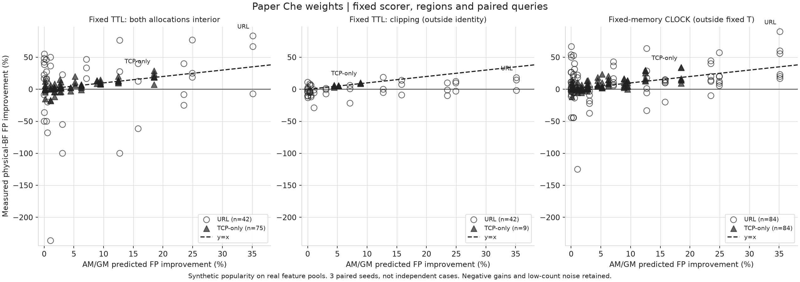
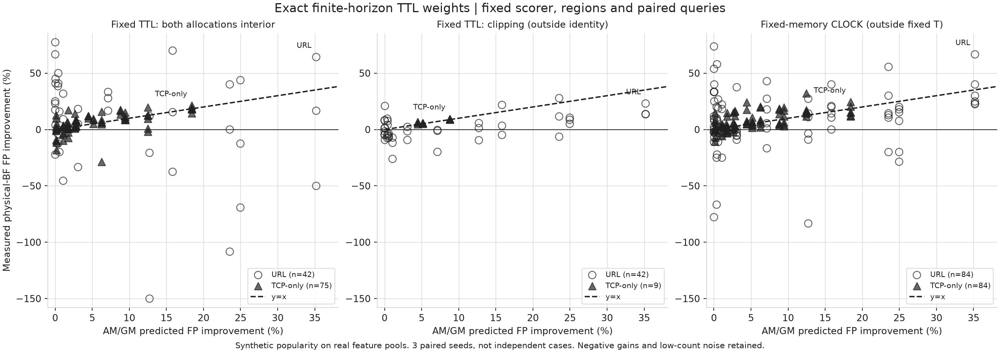

# Proposition5.3: controlled mechanism experiment

Paper reference:e256658:vldb/sections/analysis.tex, prop:gain. Two real feature pools with controlled synthetic popularity; not a new real trace.168paired settings,504physicalBFbuilds, three shared seeds. Model and regions fixed; no score/partition/cache search.

## Applicability

- Both allocations interior:117/168settings; clipping:51/168 (for both paper and exact-TTL weight definitions). Formula is evaluated only over positive-member regions; URL has4 and TCP has3 such regions in the frozen5-region layout. Empty regions are not positive-weight AM/GM terms.
- Continuous interior ratios match the AM/GM factor within1e-9relative tolerance. This verifies the implementation/algebra, not empirical CLOCK optimality.
- PhysicalBFqueries additionally have integer probe/bit allocation and finite-key/stream variability. Even in the interior panel these are not literally continuous ideal BFs. Exact-TTL M isolates finite-horizon cache approximation; paper-Che M is separately plotted.
- Fixed TTL has unconstrained occupancy, so equalT is NOT equal cache memory. The CLOCK panel instead has2048bytes per filter and therefore violates exogenousT; no theorem guarantee is claimed there.
- Regional total traffic is held constant across correlation strength; only within-region concentration changes. Empty query regions are renormalized and disclosed in raw JSON. At amplitude0, unequal region pool sizes can still make M/h nonconstant; amplitude is a controlled input, NOT the predicted gain axis.

## All paired outcomes (wins/ties/losses, no filtering)

| Weights | Dataset | Cache | Cases | Win/tie/loss | Median measured improvement |
|---|---|---|---:|---|---:|
| paper_M | url | ttl | 84 | 45/1/38 | 2.01% |
| paper_M | url | clock | 84 | 57/2/25 | 9.63% |
| paper_M | caida_tcp_flow | ttl | 84 | 70/0/14 | 5.27% |
| paper_M | caida_tcp_flow | clock | 84 | 74/0/10 | 5.09% |
| exact_M | url | ttl | 84 | 47/2/35 | 3.61% |
| exact_M | url | clock | 84 | 53/2/29 | 8.80% |
| exact_M | caida_tcp_flow | ttl | 84 | 71/0/13 | 6.22% |
| exact_M | caida_tcp_flow | clock | 84 | 71/0/13 | 5.36% |

## Interior-only association (descriptive; no independent-case p-values)

| Weights | Dataset | Cache | Cases | Spearman correlation of predicted/actual gain |
|---|---|---|---:|---:|
| paper_M | url | ttl | 42 | 0.1211 |
| paper_M | url | clock | 42 | 0.2350 |
| paper_M | caida_tcp_flow | ttl | 75 | 0.7176 |
| paper_M | caida_tcp_flow | clock | 75 | 0.6766 |
| exact_M | url | ttl | 42 | -0.2549 |
| exact_M | url | clock | 42 | 0.0002 |
| exact_M | caida_tcp_flow | ttl | 75 | 0.6581 |
| exact_M | caida_tcp_flow | clock | 75 | 0.6901 |

## Reading the figures

[Interactive, keyboard-accessible scatter and table](interactive.html) · [All plotted rows](scatter_rows.csv)

Dark versions and vector PDFs accompany both figures. Monochrome ink with circle/triangle shapes avoids categorical-color ambiguity; both modes use separately chosen high-contrast ink/surface. No data points cropped to hide regressions.

The result supports a conditional mechanism and its boundaries, not a claim that higher arbitrary variance always improves deployment, nor that the learning estimator accurately recovers the oracle M. Some URL low-FP cases are noisy and regress sharply. These losses remain in the figures and tables. New real-workload evidence is a separate round27 task.
