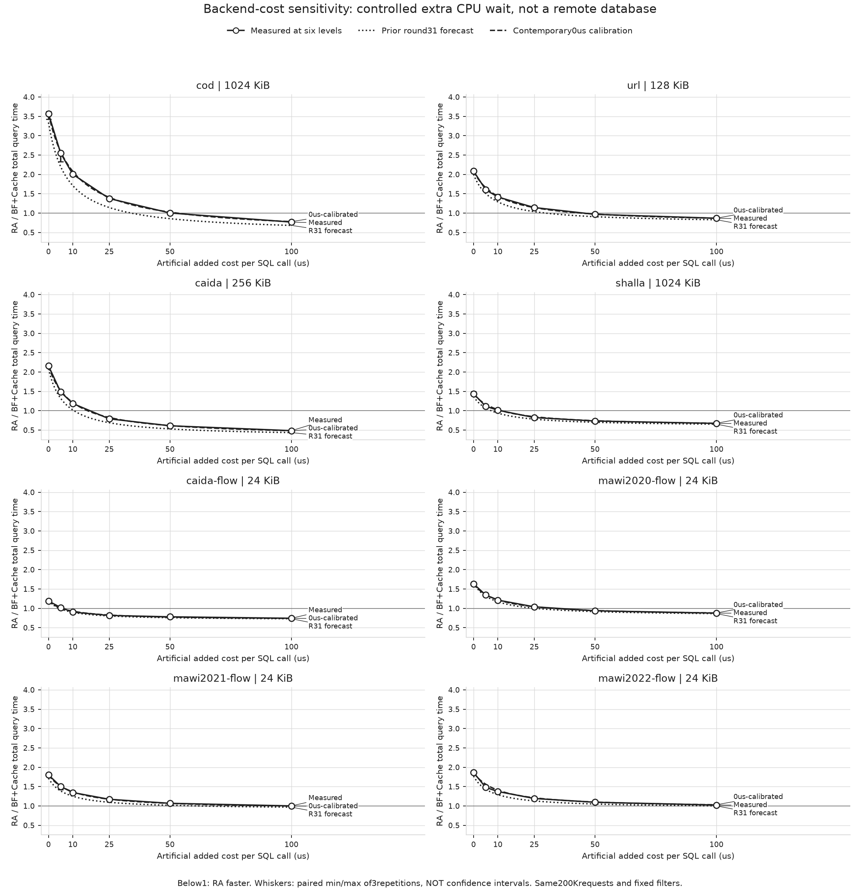

# Round34：后端成本敏感性（已完成，人工附加成本）

**8设置×6档成本×2方法×3重复，共288条实测全部完成并核验。** 固定第31轮模型、缓存预算和200000次请求；每次实际SQL调用返回后附加忙等成本，只有实际返回None才插入Cache。

- [冻结协议](plan/design-freeze.md)
- [事前预测](results/pretrial_forecast.json)
- [完整结果与模型偏差](results/report.md)
- [全部288次计时](results/timings.csv)、[48个曲线点](results/curve_points.csv)
- [完成记录](results/completion.json)、[独立核验](results/verification.json)
- [浅色曲线](results/figures/cost_ratios_light.png)、[深色曲线](results/figures/cost_ratios_dark.png)

## 结论

**提高可避免的后端调用成本，确实能让RA在部分设置中反超BF+Cache；但实测不是原推算的6/8、7/8。**

| 每次SQL附加成本 | 根据第31轮预测 | 同期0us基线校准预测 | 实测RA更快（8设置） |
| ---: | ---: | ---: | ---: |
| 0us | 0 | 0 | 0 |
| 5us | 1 | 0 | 0 |
| 10us | 2 | 1 | 1 |
| 25us | 3 | 3 | 3 |
| 50us | 6 | 5 | **5** |
| 100us | 7 | 7 | **6** |

这里按预定的“方法各自中位耗时之比”计胜负；这5个/6个胜出设置分别在对应档位的3次配对重复中都更快，但不是跨独立数据集的统计显著性结论。

100us时，RA/BF耗时比：COD约0.768、URL0.867、CAIDA0.485、Shalla0.672、CAIDA-flow0.743、MAWI20 0.876。MAWI21约1.00090，3次里2次RA更快，实际上接近打平，不能称稳定反超；MAWI22约1.02395，仍慢。

## 为什么与原预测不同

第31轮和本轮0us基线并非完全一样。本轮加入了成本适配器，运行条件也可能变化；没有独立实验将漂移归因于某一个原因。例如COD的RA/BF基线从5.166/1.546us变为7.828/2.193us，对应预测阈值从34.0变为53.0us。因此不能把旧截距直接当新实验的准确延迟。

用本轮0us中位数校准截距、保持真实调用比例为固定斜率，正成本点的绝对残差中位数约0.135us/query、最大约0.530us/query。MAWI21在100us非常接近阈值，微小偏差即可改变胜负。所有原预测、同期预测、实测和逐次结果均保留；没有为了得到8/8而增加更高成本点。



图中误差线是3次配对比值的最小/最大范围，不是置信区间。颜色不用于区分类别，线型与标记保留黑白/色觉可及性；两种主题均实际渲染检查，完整数值表另存。

## 这能说明什么，不能说明什么

- 这是**真实本地SQLite调用＋人工CPU服务成本**的受控测量，不是真实远程数据库、网络I/O或冷盘性能。忙等不等于阻塞网络等待，也可能改变CPU运行状态。
- 每次真实后端调用都付额外成本，包括成员查询；Cache命中和BF拒绝不付。288次完整放行mask、FP/SQL调用数、成员数和最终Cache均与第31轮匹配；所有成员检查0FN。
- 成本模型在这个设计下应当近似成立，本试验主要验证实现、计数与成本核算及其运行偏差，不将人工延迟符合预期包装成新的理论或生产系统证明。
- 真正影响反超的是**可避免的负查询调用**有多贵。若数据库变大后只有命中成员的查询更慢、而后端自身Bloom仍能廉价拒绝不存在key，则两方法共享的成员成本增加，不一定帮助RA反超。
- 固定单位成本差为正时，单纯增加查询次数不会让已落后的RA反超；若缓存命中率/重复性随N变化，这个固定系数推算便不再适用。
- 高成本下单位查询时间胜出，也不等于包含训练、构建和学习期开销的总时间已回本。本轮预加载模型/特征/hash，准备成本单列，未给出从零训练的盈亏平衡N。
- COD原数据库159182848B、300万成员，约53.06B/member；不能由文件大小线性估算出“3亿成员必反超”。工作集、索引、设备以及固定Filter预算下的BF负载都会变化。

## 复核与下一步

```sh
.condaenv/bin/python -I windows_research/round34_backend_cost/src/test34.py
python3 windows_research/round34_backend_cost/src/report34.py
.condaenv/bin/python -I windows_research/round34_backend_cost/src/plot34.py
```

4项单测、冻结hash、288条请求/Cache不变量检查均通过。原始实际忙等跨度、最小/最大值和请求的目标成本保留。论文没有再改动。

后续若继续，应独立测量真实RPC/存储后端的负查询成本，或隔离Python标量调度与模型推理成本；不直接造数亿条数据，不把当前人工成本曲线当作真实系统结果。
